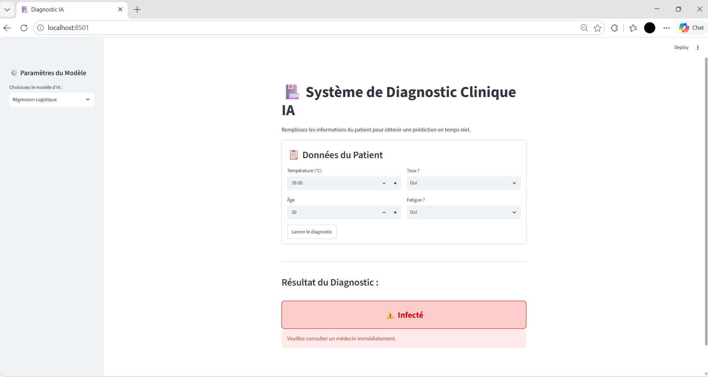

# 🏥 Système de Diagnostic Clinique IA



## 📌 Description
Ce projet est une application de diagnostic médical assisté par Intelligence Artificielle. Il a été réalisé dans le cadre d'un exercice de Programmation Orientée Objet (POO) adaptée à l'IA. 

L'application permet de saisir les données d'un patient (température, toux, fatigue, âge) et d'obtenir un diagnostic en temps réel ("Infecté" ou "Sain") en fonction du modèle d'IA sélectionné.

## 🏗️ Architecture du projet
Le projet respecte le **Principe de Responsabilité Unique (SRP)** avec une architecture modulaire :
- **`data/`** : Gestion et génération des données patients.
- **`core/`** : Le cœur de l'IA (Modèle de base, Régression Logistique, Réseau de Neurones).
- **`pipeline/`** : L'orchestration (Entraînement via `Trainer` et évaluation).
- **`utils/`** : Fonctions utilitaires (nettoyage, métriques).
- **`app/`** : L'interface utilisateur (Classe `ClinicalPredictor` et interface web Streamlit).

## 🚀 Comment lancer le projet
1. Installer les dépendances :
   ```bash
   pip install -r requirements.txt